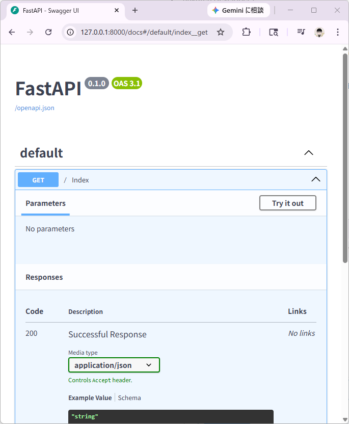
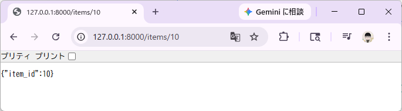
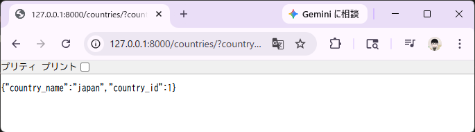
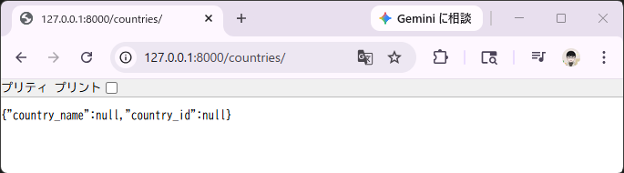
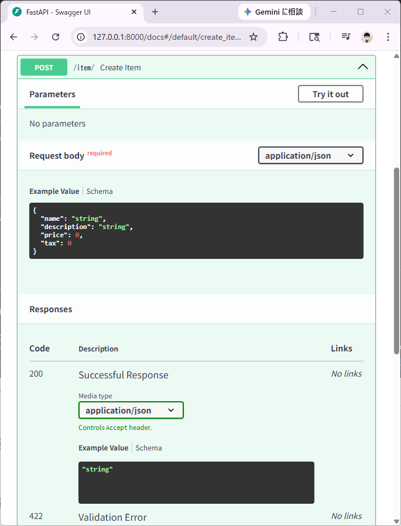
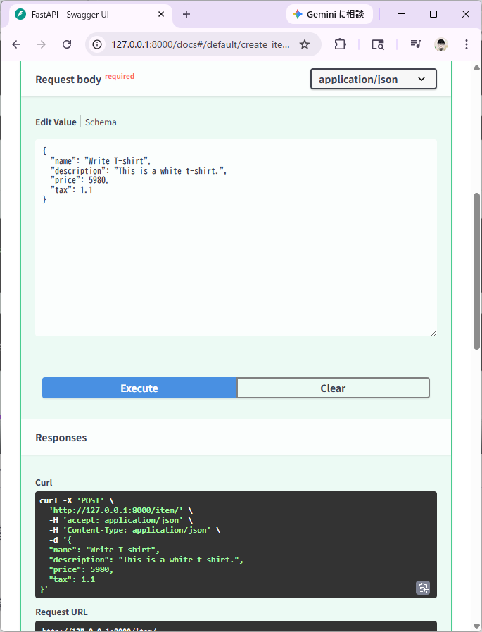
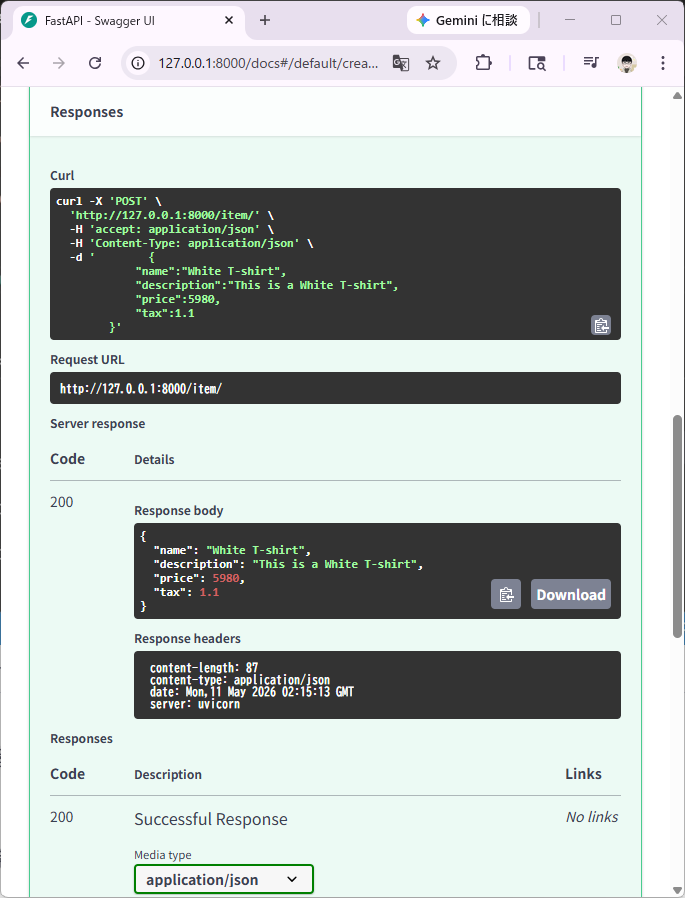
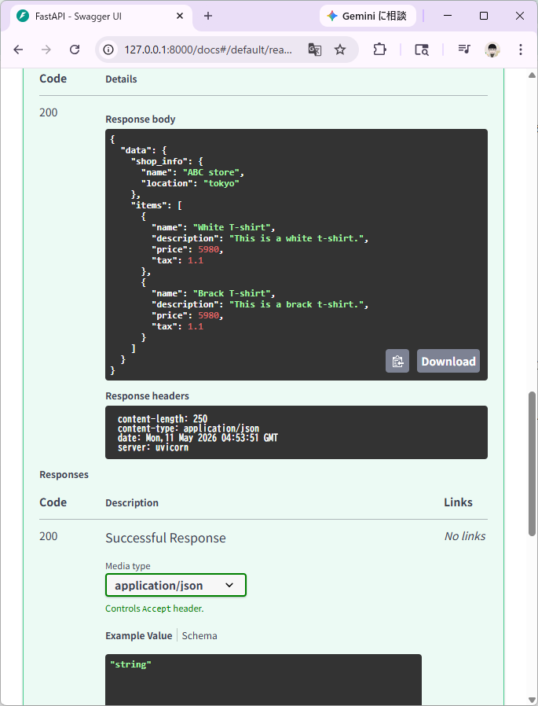
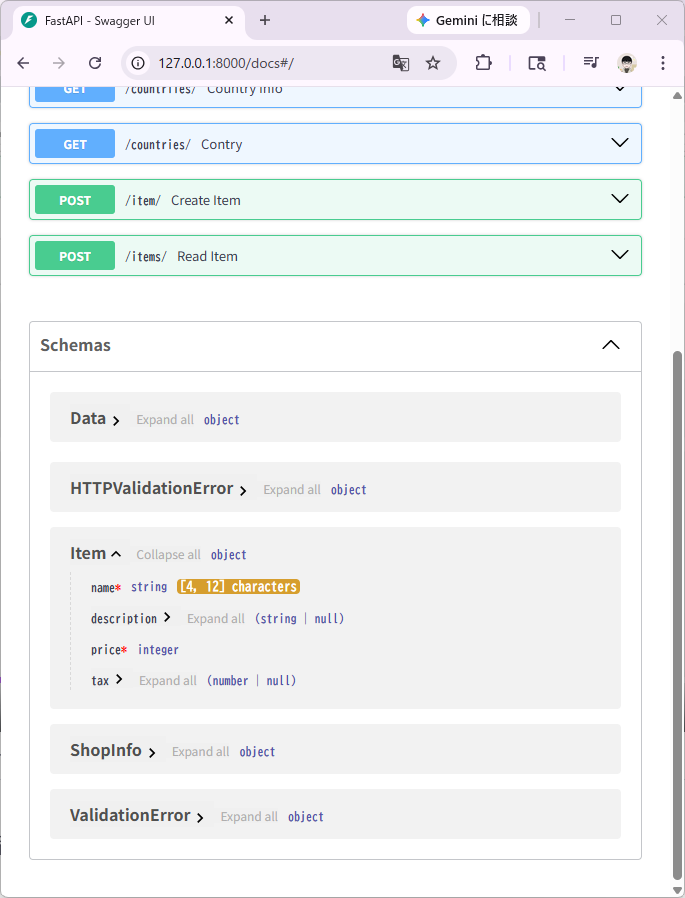

# FastAPI

Pythonの標準である型ヒント に基づいてPython3.6移行でAPIを構築するためのモダンで高速（高パフォーマンス）なWebフレームワーク

## 目次
1. [公式サイト](#01)
1. [前提条件](#02)
1. [試して動かす](#03)
1. [APIドキュメント](#04)
1. [パスパラメータ](#05)
1. [クエリパラメータ](#06)
1. [オプションパラメータ（必須でない）](#07)
1. [リクエストボディ](#08)
1. [作成したリクエストボディのアイテム情報をPythonで実行してみる](#09)
1. [リクエストボディを複雑な入れ子構造にしてみる](#10)
1. [バリデーション](#11)

<a id="01"></a>

## 公式サイト
[FastAPI](https://fastapi.tiangolo.com/ja/)

<a id="02"></a>

### 前提条件
ライブラリをインストールする
```
pip install "fastapi[standard]"
```

<a id="03"></a>

### 試して動かす
1. サンプルを用意する

    main.py
    ```
    from fastapi import FastAPI

    app = FastAPI()

    @app.get("/")
    async def index():
        return { "message": "Hellow World" }
    ```

2. main.pyを実行する

    - ターミナルでfastapiのサーバーを起動する
        ```
        fastapi dev
        ```

        以下の通りメッセージが返ってきたらサーバー起動は成功！
        ```
        FastAPI   Starting development server 🚀
    
                Searching for package file structure from directories with __init__.py  
                files                                                                   
                Importing from C:\Users\user\Documents\github\test-fastapi
    
        module   🐍 main.py
    
        code   Importing the FastAPI app object from the module with the following     
                code:                                                                   
    
                from main import app
    
        app   Using import string: main:app
    
        server   Server started at http://127.0.0.1:8000
        server   Documentation at http://127.0.0.1:8000/docs
    
        tip   Running in development mode, for production use: fastapi run
    
                Logs:
    
        INFO   Will watch for changes in these directories:                            
                ['C:\\Users\\user\\Documents\\github\\test-fastapi']
        INFO   Uvicorn running on http://127.0.0.1:8000 (Press CTRL+C to quit)
        INFO   Started reloader process [7144] using WatchFiles
        INFO   Started server process [14936]
        INFO   Waiting for application startup.
        INFO   Application startup complete.
        ```

    - 次にhttp://127.0.0.1:8000へアクセスする

        

<a id="04"></a>

### APIドキュメント
FastAPIはAPIのドキュメントを自動生成する
FastAPIのサーバーを起動後、`http://127.0.0.1:8000/docs`へアクセスするとドキュメントが作成されている



<a id="05"></a>

### パスパラメータ
URLにパスパラメータを渡すことができる

例えば、アイテム情報としてアイテムIDを引き渡す場合

main.py
```
from fastapi import FastAPI

app = FastAPI()

@app.get("/items/{item_id}")
async def read_item(item_id: int):
    return { "item_id": item_id }

```

FastAPIのサーバーを起動後、`http://127.0.0.1:8000/items/10`へアクセスする



<a id="06"></a>

### クエリパラメータ
URLの?以降に付与されるパラメータでキーと値のパラメータを渡すことができる

例えば、国情報として、国名、国IDを渡したい場合

main.py
```
from fastapi import FastAPI

app = FastAPI()

@app.get("/countries/")
async def country_info(country_name: str, country_id: int):
    return{
        "country_name": country_name,
        "country_id": country_id
    }
```
エンドポイントの`countries`へアクセスすると、`country_info関数`が呼ばれるので、引数に`country_name`と`country_id`を引き渡すように記述する

FastAPIのサーバーを起動後、`http://127.0.0.1:8000/countries?country_name=japan&country_id=1`へアクセスする



<a id="07"></a>

### オプションパラメータ（必須でない）

クエリパラメータとして、国情報として、国名、国IDを引き渡していたが、引き渡さないとエラーとなってしまうが、この国名、国IDを必須ではないオプションパラメータとすることができる

main.py
```
from fastapi import FastAPI

app = FastAPI()

@app.get("/countries/")
async def contry(country_name:Optional[str] = None, country_id:Optional[int] = None):
    return {
        "country_name":country_name,
        "country_id": country_id
    }
```
型指定でOptionalを付け[]で囲み、その中に型を指定し、値がないというNoneを設定する

`country_name:Optional[str] = None`

`country_id:Optional[int] = None`

FastAPIのサーバーを起動後、`http://127.0.0.1:8000/countries/`へアクセスすると、エラーとならず、nullとして表示される



<a id="08"></a>

### リクエストボディ
いままではHTTPSメソッドの`GET`を使用していたが、`POST`を使用してリクエスト情報（JSON形式のデータ）を送信する

例えば、アイテム情報として、名前、概要、価格、税額という情報を送信する場合

```
from fastapi import FastAPI
from pydantic import BaseModel

class Item(BaseModel):
    name: str
    description: Optional[str] = None
    price: int
    tax: Optional[float] = None

app = FastApi()

@app.post("/item/")
async def create_item(item: Item):
    return item
```

FastAPIのサーバーを起動後、`http://127.0.0.1:8000/docs/`へアクセスする

`Try it out`で、アイテム情報を試しに送信することができる



`Request Body`の`Edit Value`に送信したいアイテム情報をJSON形式で記述し`Execute`ボタンを実行する



`Responces`で実行結果が表示される

`200`として`Resopnse body`に送信したJSON形式のデータが表示されていれば正常に送信が成功している



<a id="09"></a>

### 作成したリクエストボディのアイテム情報をPythonで実行してみる

test-method.py
```
import requests

def main():
    url = "http://127.0.0.1:8000/item/"
    body = {
        "name": "White T-shirt",
        "description": "This is a White T-shirt",
        "price": 5980,
        "tax": 1.1
    }
    res = requests.post(url, json=body)
    print(res.json())

if __name__ == "__main__":
    main()
```

FastAPIサーバーが起動しているターミナルとは別に新しくターミナルを起動し上記Pythonを実行する

```
python test-method.py
```

ターミナルに次のような値が返ってきたらPythonによる実行は成功した
```
{'name': 'White T-shirt', 'description': 'This is a White T-shirt', 'price': 5980, 'tax': 1.1}
```

<a id="10"></a>

### リクエストボディを複雑な入れ子構造にしてみる

単純なJson形式データではなく、ListやDictの型でJson型データを用意した場合

Json形式データ
```
{
    "shop_info":{
        "name": "ABC store",
        "location": "tokyo"
    },
    "items":[
        {
            "name": "White T-shirt",
            "description": "This is a white t-shirt.",
            "price":5980,
            "tax":1.1
        },
        {
            "name": "Brack T-shirt",
            "description": "This is a brack t-shirt.",
            "price":5980,
            "tax":1.1
        }
    ]
}
```

main.py
```
from typing import Optional, List
from fastapi import FastAPI
from pydantic import BaseModel

class ShopInfo(BaseModel):
    name: str
    location: str

class Item(BaseModel):
    name: str
    description: Optional[str] = None
    price: int
    tax: Optional[float] = None

class Data(BaseModel):
    shop_info: ShopInfo
    items: List[Item]

app = FastAPI()

@app.post("/items/")
async def read_item(data: Data):
    return { "data": data }
```

FastAPIのサーバーを起動後、`http://127.0.0.1:8000/docs/`へアクセスし`Try it out`から`Request Body`の`Edit Value`に複雑なJson形式データを貼り付けて`Executeボタン`を実行する



<a id="11"></a>

### バリデーション

パラメータに細かいデータの検証チェックを設定することができる

例えば、アイテム名を４文字以上１２文字以内とする場合

```
from typing import Optional, List
from fastapi import FastAPI
from pydantic import BaseModel,Field

class ShopInfo(BaseModel):
    name: str
    location: str

class Item(BaseModel):
    name: str = Field(min_length=4, max_length=12)
    description: Optional[str] = None
    price: int
    tax: Optional[float] = None

class Data(BaseModel):
    shop_info: ShopInfo
    items: List[Item]

app = FastAPI()

@app.post("/items/")
async def read_item(data: Data):
    return { "data": data }
```
Itemクラスのnameを`name: str = Field(min_length=4, max_length=12)`と記述する

FastAPIのサーバーを起動後、`http://127.0.0.1:8000/docs/`へアクセスし`Schemas`の`item`を確認すると、`name`が`[4,12] characters`と記載されている



test-method.pyを実行してみるとnameが13文字数であるためエラーとなる

test-method.py
```
import requests

def main():
    url = "http://127.0.0.1:8000/item/"
    body = {
        "name": "White T-shirt",
        "description": "This is a White T-shirt",
        "price": 5980,
        "tax": 1.1
    }
    res = requests.post(url, json=body)
    print(res.json())

if __name__ == "__main__":
    main()
```

ターミナルでtest-method.pyを実行する
```
python test-method.py
```

`string_too_long`エラーが発生する
```
{'detail': [{'type': 'string_too_long', 'loc': ['body', 'name'], 'msg': 'String should have at most 12 characters', 'input': 'White T-shirt', 'ctx': {'max_length': 12}}]}
```

